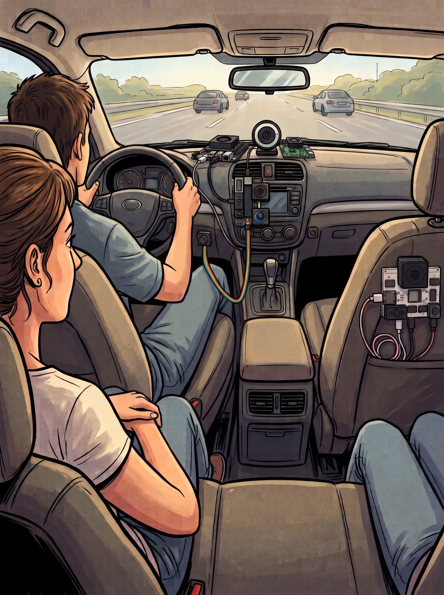

# safeDrive

**When you can't call for help, your car does.**

**Team madpiece** · Junction 2026 · [Arduino Project Hub page](https://projecthub.arduino.cc/projects/f64f85a3-6f5f-4910-8ac1-9c4b1d8b2739/)

A crash, a medical emergency or a threatening passenger can leave a driver unable to reach their phone, and the people who care about them find out too late. safeDrive is an add-on that makes the car raise the alarm by itself. A hidden SOS button, a crash or rollover, or a threat spotted by the cabin camera sends the driver's chosen contacts, within seconds, a live location, a photo, a video clip of the moments before, and an AI incident report with the street address, the nearest emergency department and exactly what to tell `112`.

Inside the car, safeDrive keeps the driver's eyes on the road. A voice assistant that runs offline sends messages, finds directions and answers questions. A back-seat intercom translates between passengers and the driver, down to their regional accent. Passengers can ask for a break or a slower ride with a simple hand sign.

  
   <em>How the safeDrive hardware could fit in a car (AI-generated illustration). In a real car, the Jetson and the UNO Q would be hidden in the glove compartment, and the driver's and back-seat boards would sit in custom-made cases. Here everything is shown in the open so you can see every device we use.</em>

**More detail:** [docs/FEATURES.md](docs/FEATURES.md) explains how each feature behaves. [docs/SETUP.md](docs/SETUP.md) covers the architecture, setup, deploy and configuration.

## What it can do

**Safety alerts.** Each one goes to every linked Telegram chat, with live location, a camera photo, a video clip and an AI incident report.

- **SOS button**: hold it for 2 s. Discreet: no sound, only two brief amber flashes when the alert goes out. ([details](docs/FEATURES.md#sos-button-port-6))
- **Accident detection**: a crash (jolt over 2.5 g) or a rollover (tilted over 75° for 3 s) starts a 10 s "Are you OK?" countdown on the screen. If nobody presses the knob to cancel, the alert goes out. ([details](docs/FEATURES.md#accident-detection-orientation-sensor-on-port-9))
- **Threat in the cabin**: Nemotron watches the camera and silently alerts the driver's contacts to a weapon, someone hitting or restraining the driver, or someone grabbing the wheel, gear lever or handbrake. ([details](docs/FEATURES.md#cabin-watch-nvidia-nemotron-35-super-vl))
- **AI incident report**: Gemini describes the clip, gives the street address, finds the nearest emergency department with Google Maps and writes what to say to `112`. ([details](docs/FEATURES.md#incident-report))
- **Last known position**: if the phone has gone quiet, alerts still send its last position (up to 24 h old), clearly marked as old.

**Voice assistant for the driver.** Press the voice button and speak; no wake word. ([details](docs/FEATURES.md#voice-assistant-button-on-port-5-mic-on-ports-3-4-speaker-on-ports-10-11))

- Send a Telegram message to a contact ("send a message to mum, I'm running late"); if it's unclear who, the car asks.
- Turn the cabin light on or off.
- Directions: puts a **Go to ...** button on the driver's phone that opens Google Maps or Waze.
- Quick facts, jokes and small talk from Gemma 4, running offline in the car.
- "Ask Google ...": a Gemini agent with Google Search, Google Maps and the car's own functions, chained in one request ("find the nearest open pharmacy and text mum I'm stopping there").

**Back seat**

- **Intercom**: the passenger's own button and speaker. They ask questions in any language and hear the answer in that language. Questions only: no messages or car controls. ([details](docs/FEATURES.md#back-seat-intercom-board-2-button-on-port-9-speaker-on-ports-3-4-mic-on-ports-13-14))
- **Translator**: the driver turns it on from the screen menu. The passenger speaks their language and the driver hears English; the driver's reply is spoken back in the passenger's exact regional variety (Portugal vs Brazil, Spain vs Mexico). ([details](docs/FEATURES.md#translator-drivers-screen-menu--translator))
- **Hand signs**: seven signs (all good, need a break, volume up, volume down, slower, faster, thank you) that the car reads out to the driver. ([how to make them](docs/FEATURES.md#hand-signs-to-try))

**Check-in and phone**

- **I'm ok**: pick it on the screen with the knob to send "I've arrived and everything is ok." with the location to one or all contacts. ([details](docs/FEATURES.md#check-in-menu-screen-on-ports-1-2-knob-on-ports-13-14))
- **safeDrive page** on the phone in the holder: shows the destination button and whether the cabin camera can see. ([details](docs/FEATURES.md#safedrive-page-phone-in-the-holder))
- **Location** from Telegram live location or OwnTracks; the hub asks the phone for a fresh fix when the last one is over 1 minute old.

## Feedback so far

We demoed the SOS button, accident detection and the AI incident reports to several of the hackathon's tech partners and to other participants. What impressed people most was how fast the photo, the video clip and the AI report arrived on Telegram after the trigger. Everyone found it useful, and one suggested pitching it to a Chinese carmaker.

## Hardware

| Device | Role |
|---|---|
| NVIDIA Jetson Orin Nano (from Wendy, running WendyOS) | The car's brain: MQTT broker, alerts, Gemma 4, Whisper and Piper, camera buffer |
| Atech 14-port board (ESP32-S3), driver | Screen, knob, SOS and voice buttons, mic, speaker, light, orientation sensor |
| Atech 14-port board (ESP32-S3), back seat | Button, mic and speaker for the intercom and translator |
| Arduino UNO Q + Arduino USB Camera | Cabin camera, streamed over Wi-Fi |
| iPhone | Wi-Fi hotspot, location, and the safeDrive page in the phone holder |

## Privacy

- **Your voice never leaves the car by default.** Speech-to-text (Whisper), the assistant's understanding and answers (Gemma 4) and its voice (Piper) all run locally on the Jetson, with no cloud service involved: they keep working with no internet connection at all.
- What someone says goes to Gemini only when they say "Google" (or "Gemini"), or while the driver has the translator on.
- Camera frames go to Nemotron on Verda for the cabin watch. A clip and the location go to Gemini only when an SOS, accident or threat alert fires.
- Camera frames are kept in RAM only, for the last 40 s.

## What's used where

Challenge requirements are in [HACKATHON.md](HACKATHON.md). Each section lists the technology, what it does in safeDrive, and the files and functions to read.

### Best Use of Nemotron

- **Model**: NVIDIA Nemotron 3.5 Super VL (`nemotron-3.5-super-vl`), on the Verda-hosted endpoint (`NEMOTRON_URL` in `jetson-hub/voice.py`).
- **What it does**: the cabin watch. `watch_loop` in `jetson-hub/voice.py` keeps sending a burst of 3 frames from the last 1.5 s. Nemotron returns a JSON verdict (`nemotron`, structured output with a JSON schema): danger level, what it sees, how many people, and any hand sign.
- **Why it matters**: a danger verdict triggers a silent alert to the driver's contacts with photo, clip and incident report (`car/vision/threat` → `send_threat` in `jetson-hub/hub.py`). Hand signs are spoken to the driver. The Gemini agent can call `cabin_status` to read Nemotron's latest verdict.
- **Improving its output**:
    - A narrow definition of danger (weapon, hitting, restraining, grabbing the controls), so blocked views and normal movement don't trigger alerts.
    - A sign is spoken once 2 of the last 3 verdicts agree. When the shared endpoint is slow (5 s or more per verdict), one verdict is enough, so nobody has to hold a sign for a minute.
    - Dark or missing frames are never sent (`covered`).
    - Temperature 0 and a fixed schema.
    - A `hands=` description in the log, for checking each verdict.

### Best Use of Gemini API

- **The problem**: after a crash or an attack, the people alerted need to know fast what happened, where, and what to do. A pin on a map and a raw video aren't enough when someone has to call `112` within a minute.
- **How we integrated it**:
    - **Incident report** (`jetson-hub/hub.py`): `describe_clip` sends the alert's video clip to Gemini for a description of what happened in the cabin. `where_and_er` uses Gemini with Google Maps grounding to find the nearest emergency department. `send_report` combines both with the street address into one message, including the sentences to read to `112`. All three lookups run in parallel, so the report lands about 10-15 s after the alert.
    - **Agent** (`ask_google`, `gemini_call`, `run_function` in `jetson-hub/voice.py`): Gemini with Google Search, Google Maps grounding at the car's location, and four car functions (`send_message`, `set_light`, `show_directions`, `cabin_status`).
    - **Translator** (`translate_turn`, `gemini_hear`, `gemini_tts` in `jetson-hub/voice.py`): Gemini hears the recording, names the language and regional variety, and translates it.
- **What's innovative**:
    - Video understanding and Maps grounding combined into one report a stressed person can act on, written to describe only what is visible and never to guess at injuries.
    - One spoken request can chain Search, Maps and actions in the physical car ("find the nearest open pharmacy and text mum I'm stopping there").
    - Audio in, regional-variety translation out, in a single call: no separate speech-to-text, and Portuguese from Portugal is answered as Portugal's, not Brazil's.
    - Privacy by design: Gemini is called only when someone says "Google", turns on the translator, or an alert fires.
- **Why Gemini**: it's the one model here that understands video and audio directly and is grounded in live Google Search and Maps data. Without it, the alert would be a location and a clip; with it, it's a plan.

### Best Use of Gemma

- **Model**: Gemma 4 E2B (`gemma4:e2b`) on Ollama, on the Jetson's GPU, with thinking off. Everything it does runs offline in the car.
- **Where** (all in `jetson-hub/voice.py`):
    - `understand`: turns the driver's words into an action (message, light, directions, answer, ask Google) as JSON, with the driver's contacts in the prompt and a fixed JSON schema.
    - `local_answer`: short spoken answers, in the passenger's own language for the back seat.
    - `say_in`: translates the car's replies into the back seat's language.
    - `prepare_llm` / `fetch_llm`: downloads the model over IPv4 and keeps it loaded.
- **Why it matters**: privacy by default. Nothing said in the car goes online unless the speaker says "Google".

### Best use of Arduino UNO Q

- The **Arduino UNO Q** with the **Arduino USB Camera** is the car's camera node. It joins the hotspot on its own and runs `unoq-camera/stream.py` as a systemd service (`unoq-camera/safedrive-camera.service`).
- `stream.py` finds the camera (`find_camera`) and serves its own JPEGs at 1280×720, 15 fps (`/stream.mjpg`, `/frame.jpg`, `/preview.mjpg`). It reports `/health`, including when the picture is dark, recovers from stuck auto-exposure (`kick_exposure`), and serves a live view with the hand-sign guide (`unoq-camera/icons/`).
- Its frames feed every AI feature that needs vision: Nemotron's cabin watch and hand signs (`watch_loop` in `jetson-hub/voice.py`), the alert photo and clip (`jetson-hub/vision.py`) and Gemini's incident report (`describe_clip` in `jetson-hub/hub.py`).
- The AI models run on the Jetson and on Verda, not on the UNO Q itself, and no Modulino sensors are used.

### Verda Compute Track

- **What we built on Verda**: the cabin watch. A car's camera is watched continuously by NVIDIA Nemotron 3.5 Super VL, served by the Verda Inference API from a dedicated container endpoint (`NEMOTRON_URL` and `VERDA_INFERENCE_KEY` in `jetson-hub/voice.py`).
- **Ambition: what compute made possible**: a 120B-parameter vision-language model (12B active) judging every few seconds whether the driver is in danger and reading passengers' hand signs. That's far beyond the car's Jetson Orin Nano, whose GPU already runs Gemma 4 for the voice assistant. With Verda, a small computer in the car gets a frontier-scale vision model.
- **Fit: why the Inference API**: no servers to run during a hackathon, an OpenAI-compatible API we called with plain HTTP and a JSON schema for structured verdicts, and European hosting: video from inside a private car is processed in Europe, by an open-weight model.
- **Process**, from the git history:
    1. **First version** (`Add a voice assistant with Gemma, Gemini and Nemotron`): bursts of 3 frames from the last 1.5 s, so the model sees movement such as a hand reaching for the wheel, scaled down to 640 px (about 30 KB each) to cut the upload over a phone hotspot. One request at a time, with a JSON-schema verdict.
    2. **Less waste** (`Show a camera-off icon when the camera can't see`): dark or stale frames are never sent, so no GPU time is spent on a covered lens or a parked car at night, and the driver sees when the watch is paused.
    3. **Hand signs** (`Improve hand signs, audio and the camera page`): a `hands` field that makes the model describe the hands across all frames before it names a sign. Voting adapts to the endpoint's speed.
    4. **Robustness**: when the endpoint is busy or fails, the watch retries after 15 s instead of stopping.
- **Path to scale**: each car sends one small request at a time and nothing while the camera can't see, so load grows linearly with the number of cars on the road. A fleet would move to Verda's auto-scaling containers, with a smaller model on the car's Jetson as an offline fallback. The same endpoint can serve taxis, school buses and delivery fleets, with all cabin video staying in Europe.

### Atech Real World Challenge

Two Atech 14-port boards (ESP32-S3) are the car's body: every input and output in the car goes through them. The firmware is written as Atech projects, and the `atech` tool (`atech==1.0.0a12`) builds, validates and flashes it on the Jetson.

| Module | Port(s) | Used for | Where |
|---|---|---|---|
| `st7735_tft` screen | 1-2 | Menu (check-in, translator), what the car heard and answered, camera-off icon | `atech-flasher/project.yaml` |
| `microphone` | 3-4 | Driver's voice, streamed to the Jetson over UDP | `project.yaml` (Voice section) |
| `button` | 5 | Voice button (push to talk, green while listening) | `project.yaml` |
| `button` | 6 | SOS (hold 2 s) | `project.yaml` (Scenario 2) |
| `neopixel` grid | 7 | Cabin light, switched by voice | `project.yaml` |
| `icm40608` IMU | 9 | Crash and flip detection | `project.yaml` (Accident detection section) |
| `speaker` | 10-11 | Spoken answers, translations, hand signs | `project.yaml` |
| `rotary_encoder` knob | 13-14 | Menu navigation, cancelling the accident countdown | `project.yaml` |
| Board 2: `button`, `speaker`, `microphone` | 9, 3-4, 13-14 | Back-seat intercom and translator | `atech-flasher/passenger.yaml` |

- **Build and flash**: `atech-flasher/runner.py` runs `atech validate`, builds both projects with PlatformIO, tells the two boards apart on USB, flashes each and streams their logs.
- **AI and external APIs** (bonus): the boards talk MQTT to `jetson-hub/`, which connects them to Gemma, Gemini, Nemotron, Google Maps, OpenStreetMap and Telegram.
- **Real problem, real users**: the driver can call for help without looking at a phone, the driver's contacts hear about a crash even if nobody in the car can answer, and passengers can talk to the driver without distracting them.

## How fast it is

Measured on the hardware on 14 November 2026, in the middle of Junction 2026. The car reached the internet through a phone hotspot on a crowded venue network, and the cloud endpoints were shared with many other teams testing at the same time. Expect every online step to be faster on a normal connection and a dedicated endpoint.

| Step | Where it runs | Time |
|---|---|---|
| Understanding a voice command (Gemma 4 E2B) | Jetson, offline | 1.7-2.0 s |
| Translating one turn, either direction (Gemini) | Cloud | 2.7-3.5 s |
| "Ask Google" with a web search (Gemini agent) | Cloud | about 10 s |
| AI incident report after an alert (Gemini, Maps, OpenStreetMap) | Cloud | about 10-15 s |
| One cabin-watch verdict (Nemotron on Verda) | Cloud | a few seconds when the shared endpoint isn't busy |

## Next steps

- **Custom hardware with Arduino and Atech.dev**: purpose-built, encased boards for the driver's console and the back seat, a discreet SOS button that fits anywhere, and the Jetson and UNO Q hidden in the glove compartment.
- **Connect to the car**: read the car's own sensors over CAN bus or OBD-II (airbag deployment, speed, seatbelts, doors) for more reliable crash detection, and control the media system, so the radio turns down when the car speaks or when a passenger signs "volume down". Use the car's own speakers and microphones.
- **Call emergency services**: hand the incident report and location to Europe's eCall system or the local emergency centre, with a confirmation step so false alarms never reach them.
- **Watch the driver too**: detect drowsiness, distraction or a driver who slumps over, and warn them or alert their contacts.
- **Protect who's left in the car**: alert when a child or pet is left in a parked car that's getting hot.
- **Faster and more accurate AI**: work with Google, NVIDIA, Verda and Wendy to cut latency, run a smaller vision model on the Jetson so the cabin watch also works offline, and tune the models on real cabin footage.
- **Partner with a carmaker**: offer safeDrive as a factory option or a dealer-fitted accessory, built into the car's screen and app.
- **More drivers**: taxi, ride-hailing and delivery fleets, school transport, new and older drivers, and insurers who reward safer driving.

## Design choices and known limits

- **A person decides to call 112.** Nothing calls emergency services automatically: the alert and incident report give the driver's contacts what they need to make the call, so a false alarm never sends an ambulance.
- The camera has no infrared: in a dark cabin, Nemotron isn't asked and the driver's screen shows a crossed-out camera icon.
- "Ask Google", the translator and the incident report need the internet; with no `gemini_api_key`, the rest still works.
- The safeDrive page can't keep the iPhone's screen on by itself (Auto-Lock must be set to Never), and it can only open Google Maps or Waze from a tap.

## Thanks

safeDrive was built in one weekend at [Junction 2026](https://2026.hackjunction.com/). Thank you to the Junction organisers and volunteers, and to the partners whose hardware, models and help made it possible: **Atech** for the modules and the firmware platform, **Arduino** for the UNO Q, the camera and the Modulinos, **NVIDIA** and **Verda** for Nemotron and the GPUs that run it, **Google DeepMind** for Gemini and Gemma, and **Wendy** for the Jetson Orin Nano and WendyOS. Last but not least, thank you to the judges for their time, and to everyone who tried safeDrive, shared their feedback and voted for us during the hackathon.

## Licence

[MIT](LICENSE), © 2026 team madpiece.
